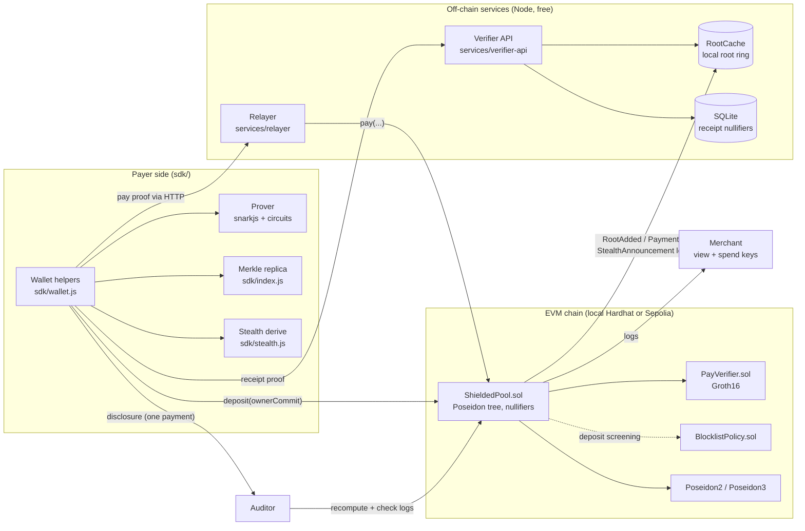
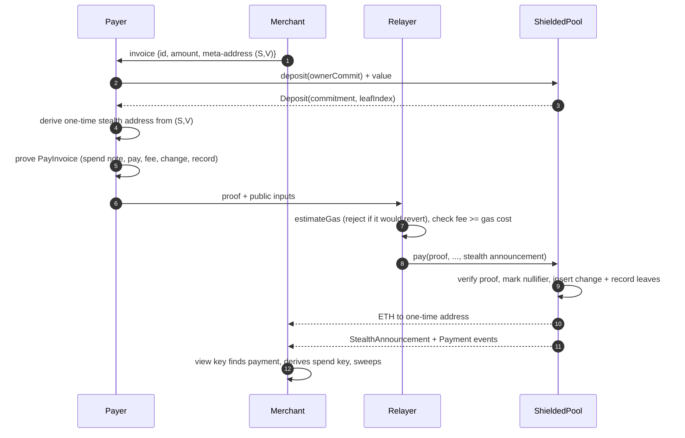
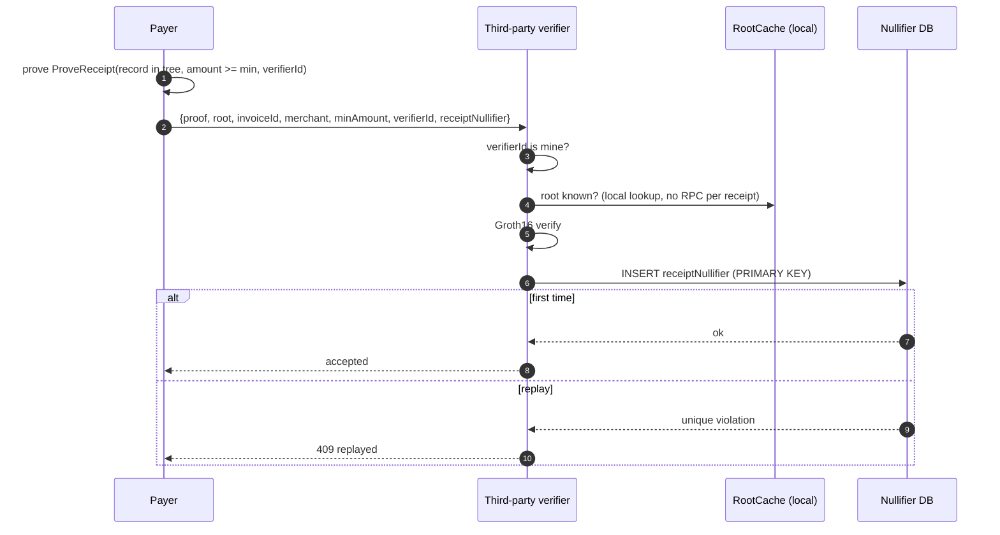
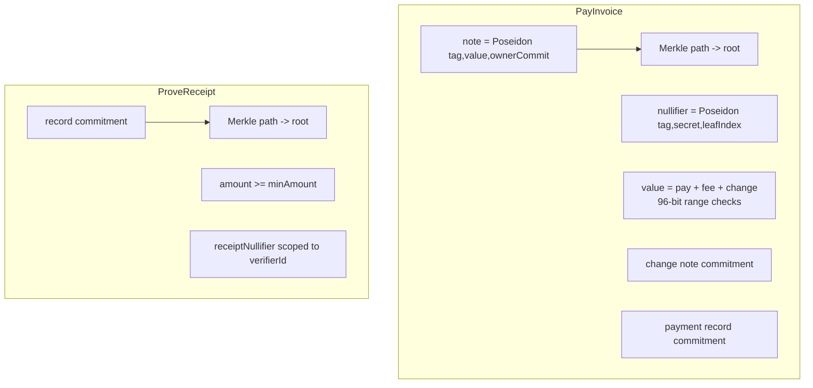
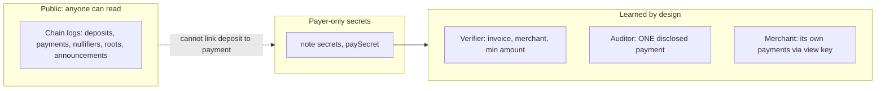
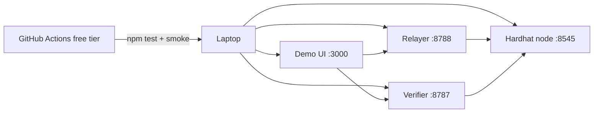

# Architecture

## 1. System overview

## 2. Data model
| Object | Definition |
|---|---|
| ownerCommit | `Poseidon(TAG_OWNER, secret)` |
| note | `Poseidon(TAG_NOTE, value, ownerCommit)`; the contract computes it on deposit from `msg.value` |
| nullifier | `Poseidon(TAG_NULL, secret, leafIndex)` |
| payment record | `Poseidon(TAG_RECORD, invoiceId, merchant, amount, paySecret)`, inserted in the same tree |
| receipt nullifier | `Poseidon(TAG_RECEIPT, paySecret, invoiceId, verifierId)` |

All tags are distinct constants (`circuits/lib/common.circom`), so one hash can never be reused as another.

## 3. Payment sequence

## 4. Receipt sequence (the core novelty)

## 5. Circuits

Public inputs, pay: `root, nullifier, payAmount, invoiceId, merchant, relayer, fee, changeCommitment, recordCommitment`.
Public inputs, receipt: `root, invoiceId, merchant, minAmount, verifierId, receiptNullifier`.
The contract passes `msg.sender` as `relayer`, which binds who may submit and collect the fee.

## 6. Trust boundaries

## 7. Deployment (all free)

Optional: deploy contracts to Sepolia with faucet ETH and a free public RPC; run the same services against it.

## 8. Directory map
| Path | Purpose |
|---|---|
| `circuits/` | `pay.circom`, `receipt.circom`, `lib/common.circom` |
| `contracts/` | `ShieldedPool.sol`, `BlocklistPolicy.sol`, `generated/PayVerifier.sol` |
| `sdk/` | notes, tree replica, proving, stealth, compliance, chain sync, wallet glue |
| `services/relayer`, `services/verifier-api`, `services/demo` | HTTP services and the demo daemon/UI |
| `scripts/` | setup (ceremony), deploy, demo orchestrator, smoke, bench |
| `test/` | contract, circuit, SDK, service and invariant tests |
| `docs/` | SECURITY, CEREMONY, benchmarks |
